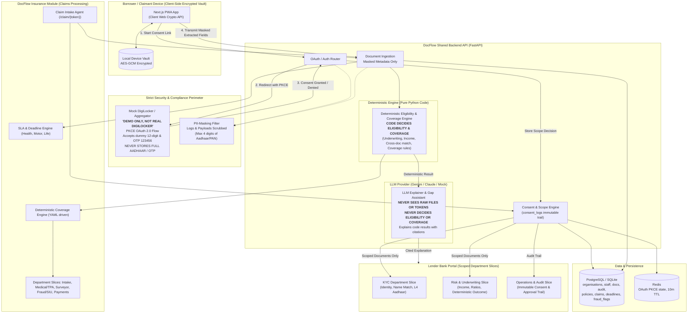

# DocFlow System Architecture

## Insurance Module Architecture & Separation
The Insurance module runs alongside the lending flow within the same shared API backend and reuses core secure components:
1. **Mock DigiLocker Provider**: Reused for identity documents (PAN, Aadhaar masked, Driving Licence, Registration Certificate).
2. **Device Vault & Hybrid Crypto**: Claim packages use AES-256-GCM client-side encryption and RSA-OAEP public key wrapping.
3. **Deterministic Coverage Engine**: Coverage rules are YAML-configured and executed purely in deterministic Python code; the LLM NEVER decides coverage or approves/rejects a claim.
4. **Single-Shot Consolidated Query**: Missing documents are gathered into a single consolidated request rather than intermittent requests.
5. **Departmental Slicing**: Slices claims into Claims Intake, Medical/TPA, Surveyor, Fraud/SIU, and Payments.

## Security & Compliance Invariants
1. **Never Collect Real Aadhaar/OTP in our UI**: Only redirected to official aggregator or explicit `DEMO ONLY` mock page.
2. **Never Persist Full Aadhaar / OTPs**: Only last 4 digits stored anywhere in database or memory logs.
3. **LLM Redaction Boundary**: The LLM provider only receives masked JSON schema dictionaries. Never passes raw files, tokens, or PII.
4. **Deterministic Decision Invariant**: Eligibility is 100% computed by Python business rules (`DeterministicEligibilityEngine`). LLM provides explanation and citations only.
5. **Departmental Scoping**: KYC, Risk, Credit, and Ops departments receive strictly partitioned slices of data.
